# Week 2: Footprinting, Reconnaissance & Network Scanning

## Overview
This document logs my Week 2 penetration testing and reconnaissance tasks for the **Networkwalks Cybersecurity Internship (Batch B084)**, covering passive/active information gathering on `networkwalks.com` via Kali Linux CLI and topology mapping on `scanme.nmap.org` via Zenmap.

## Scope & Target Information
- **Footprinting Target:** `networkwalks.com`
- **Scanning Target:** `scanme.nmap.org`
- **Key Tools:** `whois`, `whatweb`, `nslookup`, `curl`, `wafw00f`, `dnsrecon`, `nmap`, `Zenmap`

## Summary of Activities
1. **Domain & DNS Footprinting (`networkwalks.com`):** Retrieved registrar details (`whois`), resolved IPs, and enumerated NS, MX, and TXT records (`nslookup`, `dnsrecon`).
2. **Web & WAF Fingerprinting:** Identified CMS/server tech (`whatweb`), inspected HTTP responses (`curl`), and detected firewall filters (`wafw00f`).
3. **Port Scanning & Topology (`nmap` & `Zenmap`):** Scanned open ports (`80/443`) and performed deep OS, service, and network hop mapping on `scanme.nmap.org`.

## Screenshots

### 1. WHOIS Lookup
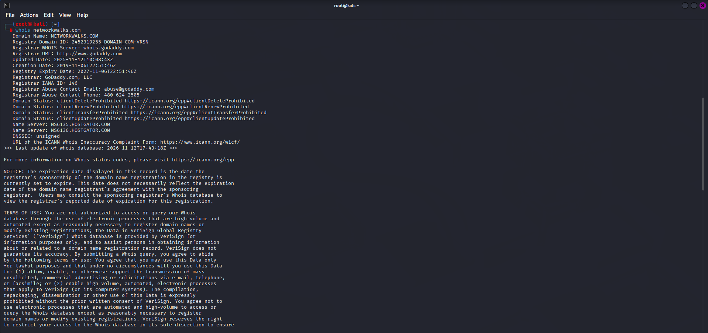

### 2. WhatWeb Technology Fingerprinting
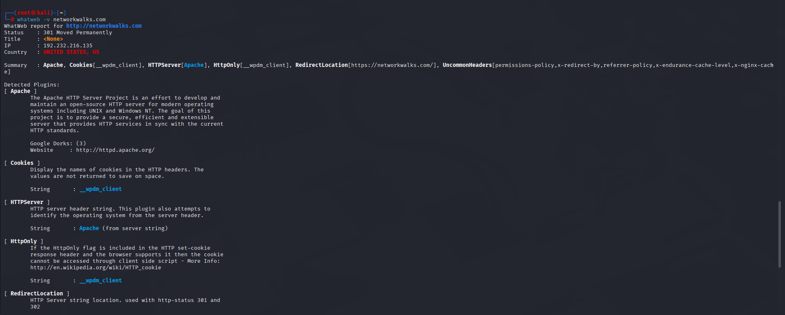
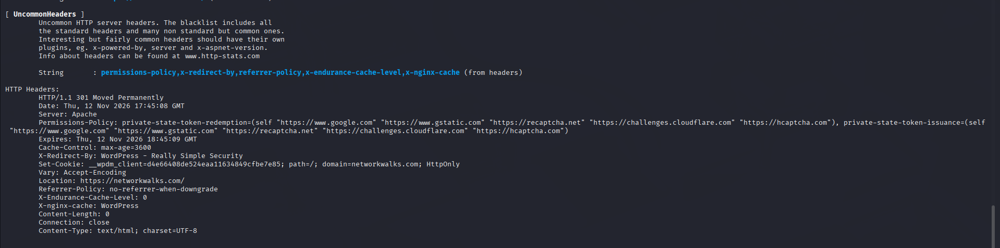

### 3. Nslookup DNS Resolution
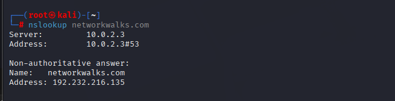

### 4. cURL HTTP Header Inspection
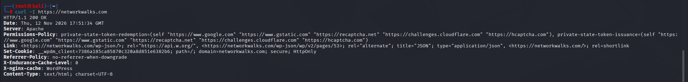

### 5. Wafw00f Firewall Detection
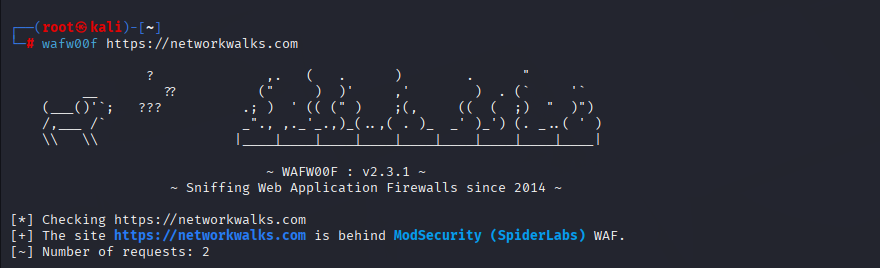

### 6. DNSRecon DNS Enumeration
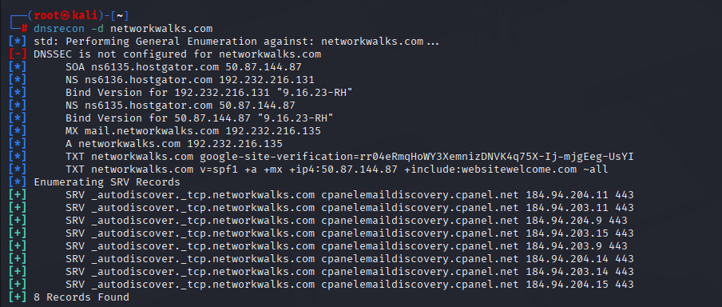

### 7. Nmap Service Version Scan
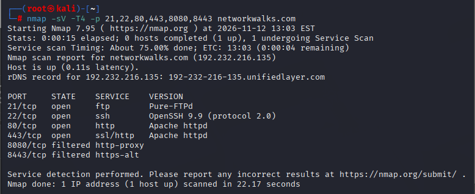

### 8. Zenmap Intense Scan Output
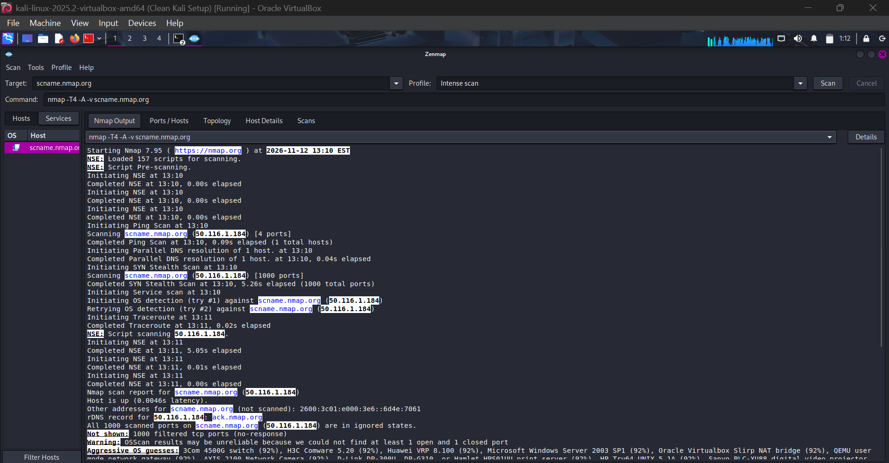

### 9. Zenmap Ports / Hosts View
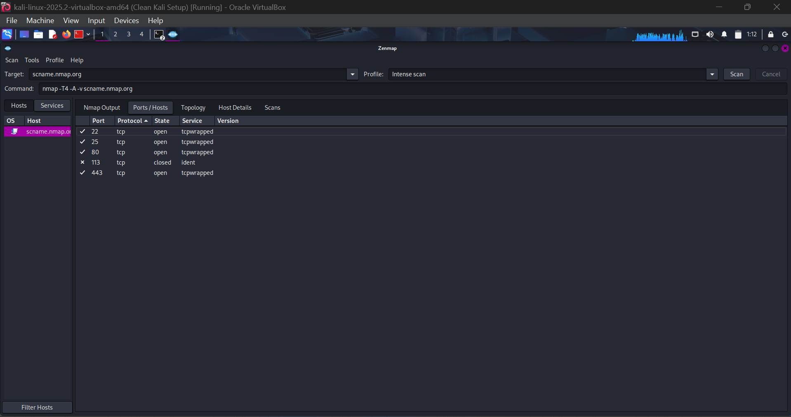

### 10. Zenmap Network Topology View
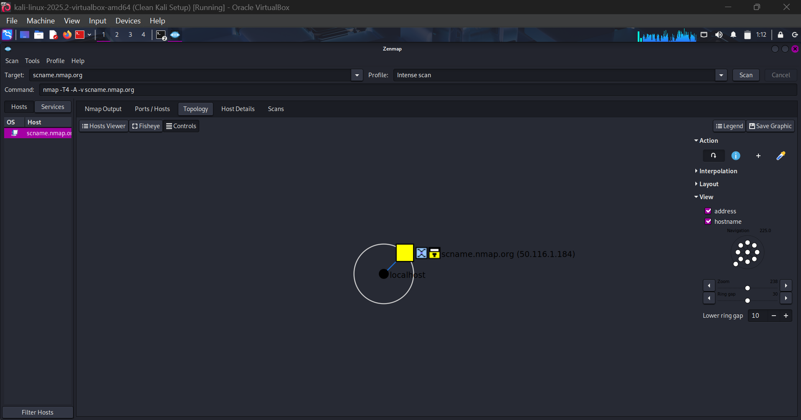

### 11. Zenmap Host Details View
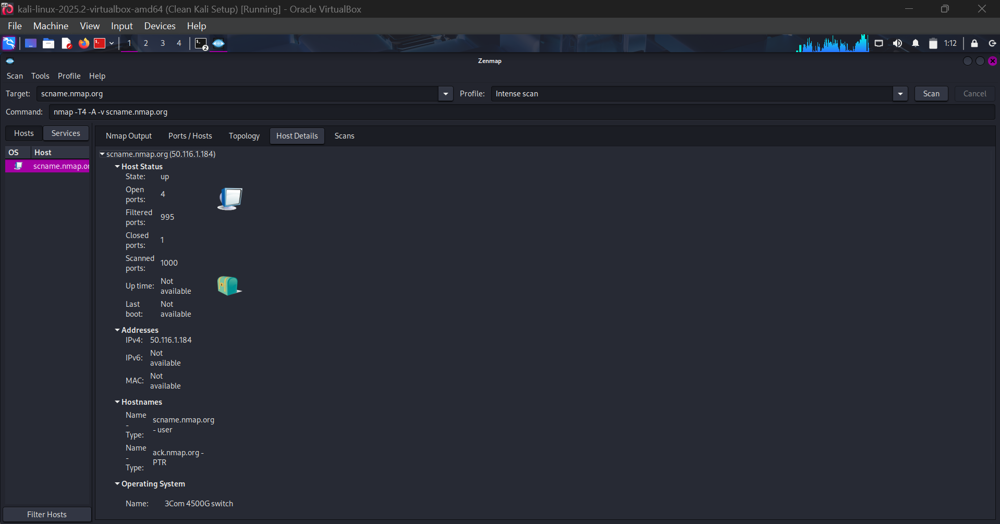

## Author
- **Name:** Jai Bhushan Rane | **Intern ID:** NW-084-3I7 | **Batch:** B084
