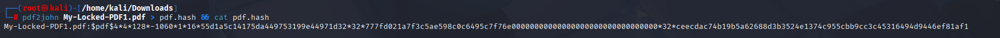
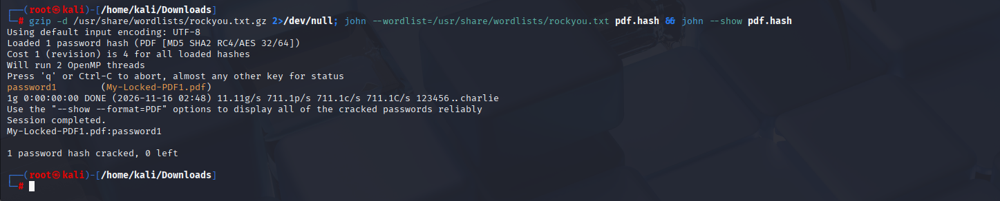
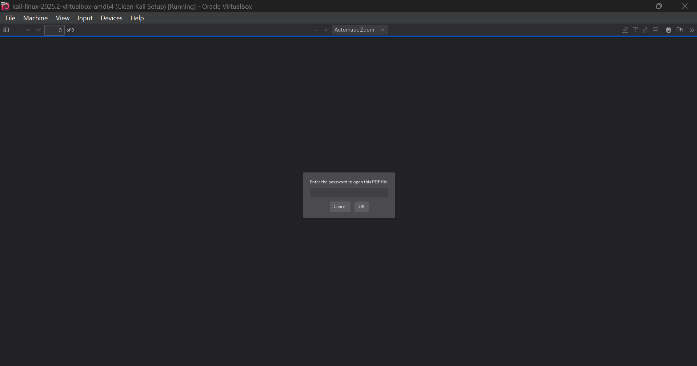
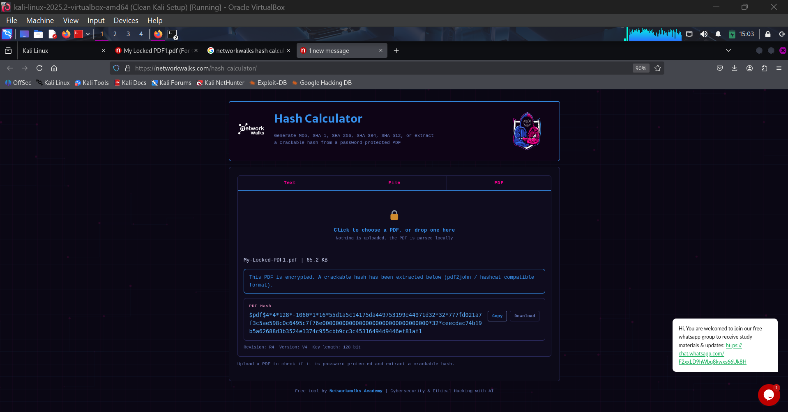
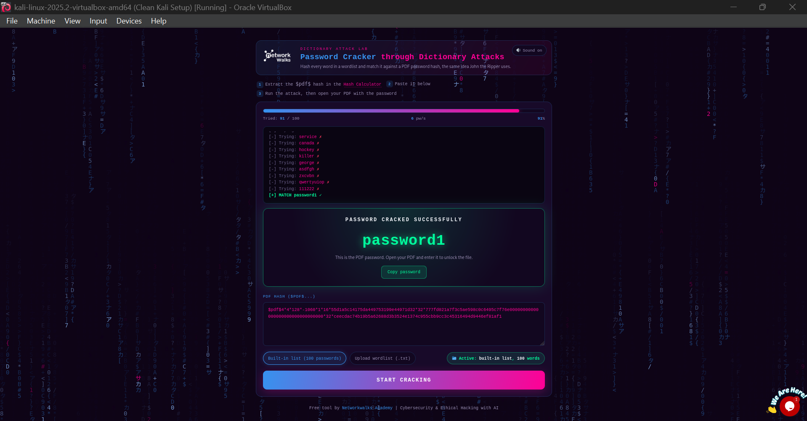

# Week 3: Password Auditing & Hash Cracking (John the Ripper & NW Tools)

## Overview
This document logs my Week 3 password recovery and cryptographic auditing labs for the **Networkwalks Cybersecurity Internship (Batch B084)**, demonstrating offline dictionary attacks with John the Ripper (`JTR`) in Kali Linux and online hash recovery using Networkwalks security utilities.

## Scope & Target Information
- **Target File:** `My-Locked-PDF1.pdf` (Authorized Training Lab File)
- **Tools Used:** `pdf2john`, `John the Ripper (JTR)`, `rockyou.txt` wordlist, Networkwalks Hash Calculator, Networkwalks Password Cracker

## Summary of Activities
1. **Hash Extraction (`pdf2john`):** Extracted the cryptographic PDF password hash (`$pdf$...`) from `My-Locked-PDF1.pdf` in Kali Linux.
2. **Offline Dictionary Attack (`John the Ripper`):** Cracked the extracted hash using the `rockyou.txt` wordlist (`john --wordlist=...`) and verified the recovered plaintext password via `john --show`.
3. **Document Decryption Verification:** Opened the protected PDF using the recovered password to verify full file access.
4. **Online Hash Generation & Cracking:** Replicated hash extraction and password recovery using the Networkwalks Hash Calculator and Networkwalks Password Cracker web tools.

## Screenshots

### 0. /home/kali/Downloads Location where the file is kept

### 1. PDF Hash Extraction (`pdf2john`)

### 2. Password Cracking with John the Ripper

### 3.1. Unlocked PDF Verification/Enter the found password

### 3.2. Unlocked PDF Data/Flag shown

### 4. Networkwalks Hash Calculator

### 5. Networkwalks Online Password Cracker

## Author
- **Name:** Jai Bhushan Rane | **Intern ID:** NW-084-3I7 | **Batch:** B084
