# Week 4 Capstone Project: Black-Box Penetration Testing Report — Mediroza General Hospital

### Phase 0: Pre-Engagement Footprinting & Infrastructure Enumeration
Before interacting with the web application portals, passive and active reconnaissance was performed against `medirozahospital.com` to map DNS records, server headers, WAF presence, open network ports, and web server configurations (`whois`, `nslookup`, `whatweb`, `curl`, `wafw00f`, `dnsrecon`, `nmap`, and `nikto`).

#### Evidence — Reconnaissance & Scanning (`./commands/`)
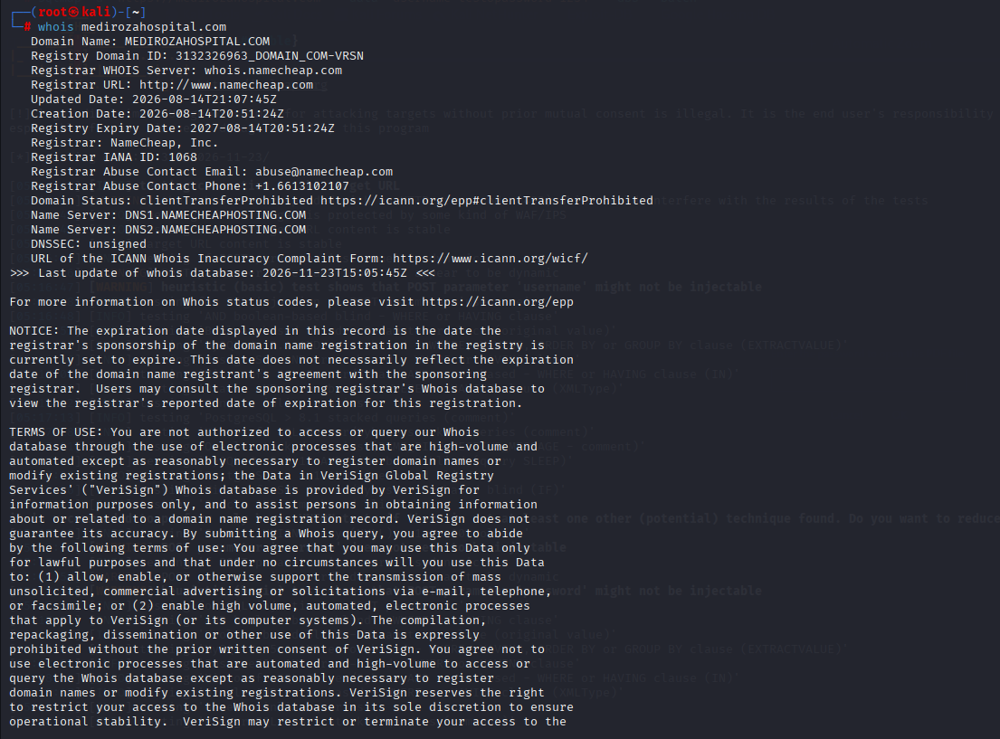

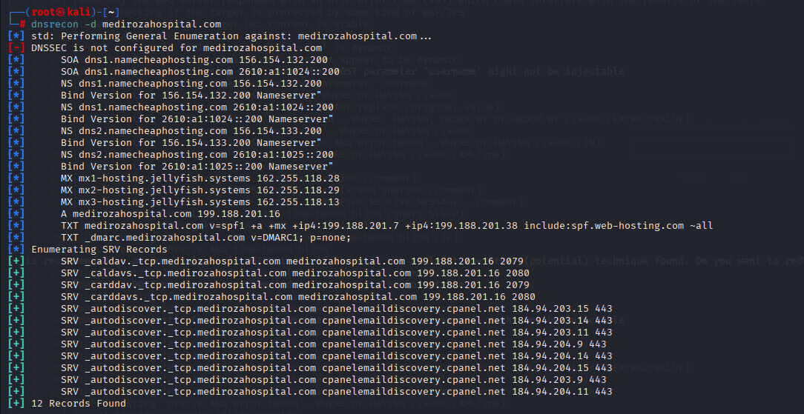

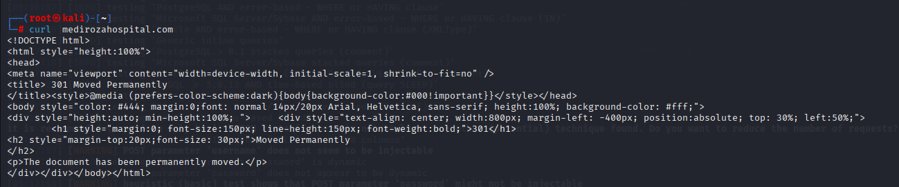
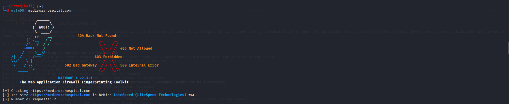
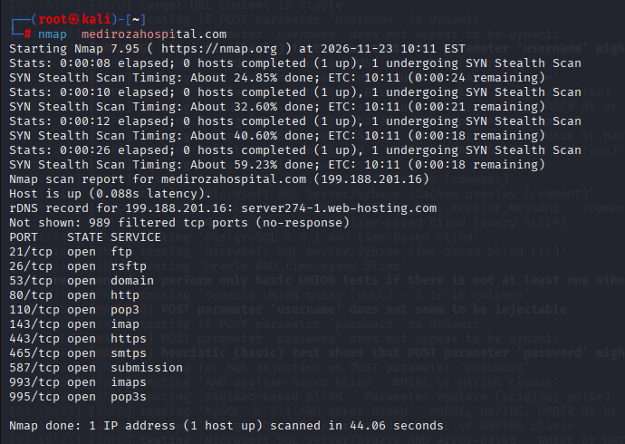
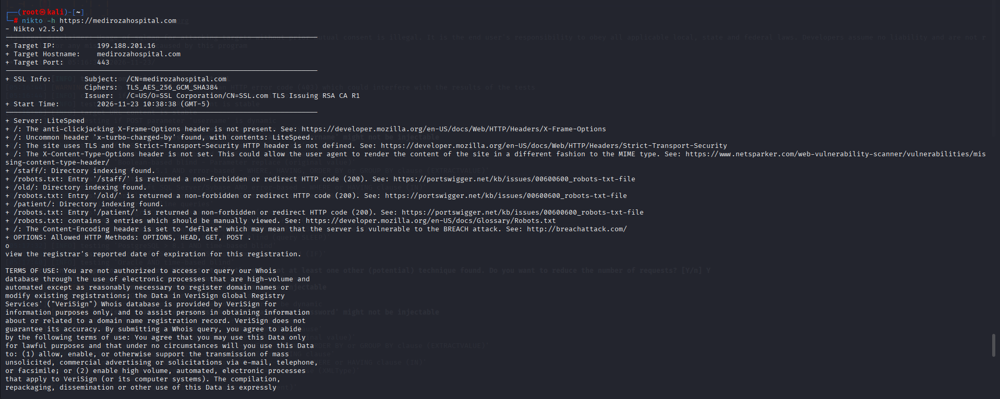
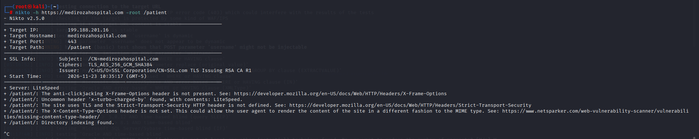

## 01. Executive Summary
A black-box security assessment was conducted against **Mediroza General Hospital** (`https://medirozahospital.com`) as part of the **Networkwalks Cybersecurity Internship (Batch B084)**. The objective was to evaluate the security posture of the hospital's public-facing web infrastructure, patient portal access controls, document encryption practices, and sensitive data storage.

The assessment uncovered multiple **Critical** and **High** severity vulnerabilities, including exposed directory listings, sensitive administrative paths disclosed via `robots.txt`, weakly encrypted patient medical reports (`patient_report_1.pdf`, `patient_report_2.pdf`, `patient_report_3.pdf`), and an unauthenticated full database backup (`mediroza_db_backup_2019.sql`) containing staff compensation and confidential shareholder records. Immediate remediation is recommended to prevent unauthorized access to Protected Health Information (PHI) and corporate financial data.

---

## 02. Scope and Methodology

### Target & Engagement Details
- **Target Application:** `https://medirozahospital.com` (Mediroza General Hospital)
- **Assessment Type:** Authorized Black-Box Penetration Test
- **Assessor:** Jai Bhushan Rane | **Intern ID:** `NW-084-3I7` | **Batch:** `B084`
- **Tools Utilized:** Web Browser & Developer Inspection, `pdf2john`, `John the Ripper (JTR)`, `pdfcrack`, `rockyou.txt` Wordlist, Networkwalks Hash Calculator, Networkwalks Password Cracker, `grep` / Text Analysis

### Assessment Methodology
1. **Reconnaissance & Directory Enumeration (Milestone 1):** Inspected public metadata (`robots.txt`), analyzed directory indexing configurations across restricted paths (`/patient/`, `/staff/`, `/old/`), and verified authentication/error-handling behavior.
2. **Cryptographic & Password Auditing (Milestone 2):** Extracted password hashes from retrieved patient PDF documents (`pdf2john` and Networkwalks Hash Calculator) and evaluated password entropy via offline dictionary and brute-force mask attacks (`John the Ripper`, `pdfcrack`, and Networkwalks Password Cracker).
3. **Sensitive Data & Backup Exposure Analysis (Milestone 3):** Audited exposed backup directories (`/old/`) and inspected leaked SQL database dumps (`mediroza_db_backup_2019.sql`) for exposed PII, employee salaries, and shareholder records.
4. **Risk Classification & Remediation Reporting (Milestone 4):** Rated findings by exploitability and business impact and documented actionable remediation steps.

---

## 03. Findings and Proof of Exploitation

### Milestone 1: Initial Access & Patient Lab Report Retrieval
- **Finding 1.1 — Sensitive Directory Disclosure via `robots.txt`:** Inspecting `/robots.txt` explicitly revealed restricted administrative and user directories (`/patient/`, `/staff/`, and `/old/`).
- **Finding 1.2 — Unauthenticated Directory Indexing & Portal Exposure:** Apache directory listing was left enabled across sensitive folders, exposing application scripts (`portal.php`, `download.php`, `error_log`) and enabling retrieval of three password-protected patient medical lab reports (`patient_report_1.pdf`, `patient_report_2.pdf`, `patient_report_3.pdf`).

#### Evidence — `robots.txt` & Directory Discovery

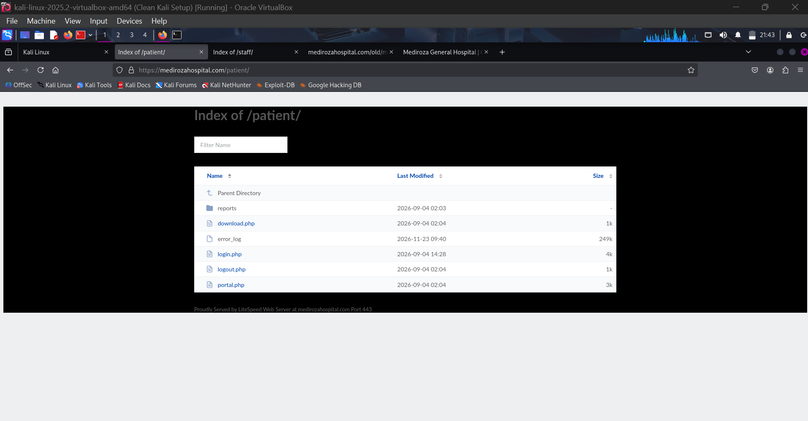
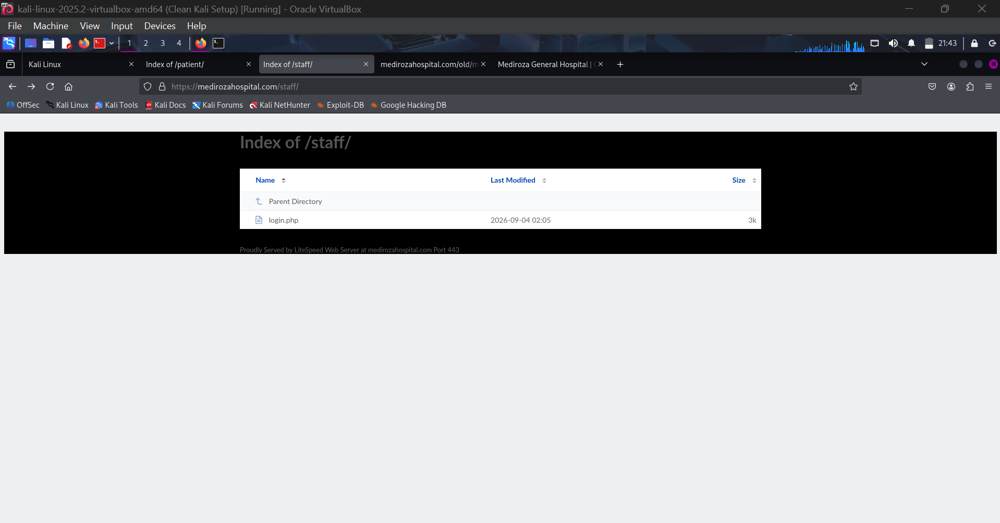

#### Evidence — Patient Directory & Report Access

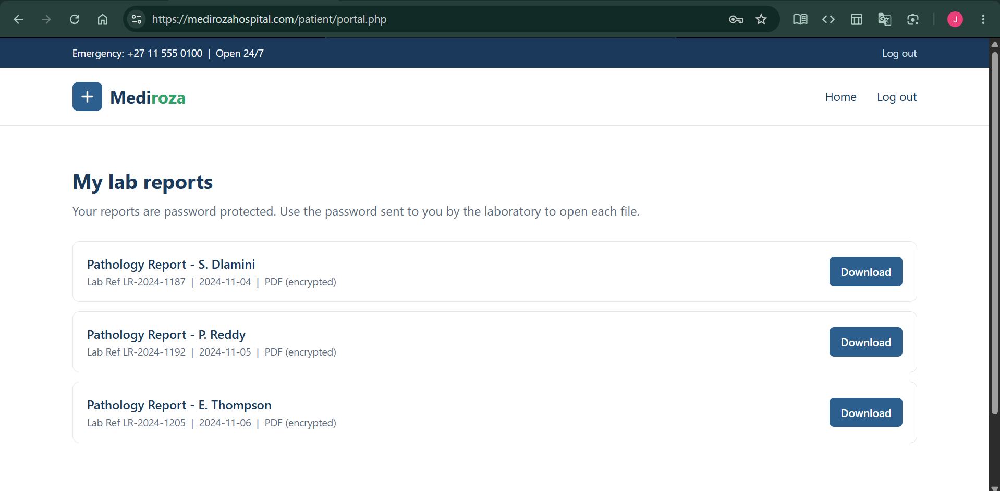

---

### Milestone 2: PDF Encryption Auditing & Data Extraction
- **Finding 2.1 — Weak Document Passwords on Patient Medical Reports:** Cryptographic hashes (`$pdf$2*3*128...`) were extracted from all three patient PDF files and audited using both offline CLI tools (`pdf2john`, `John the Ripper`, `pdfcrack`) and Networkwalks' online cryptographic utilities:
  - **`patient_report_1.pdf`:** Protected with a purely numeric sequence (`123456`).
  - **`patient_report_2.pdf`:** Protected with a top-10 dictionary word (`password`).
  - **`patient_report_3.pdf`:** Protected with a predictable keyboard symbol sequence (`!@#$%^&`).

#### Evidence — Hash Extraction (`pdf2john` & Networkwalks Hash Calculator)
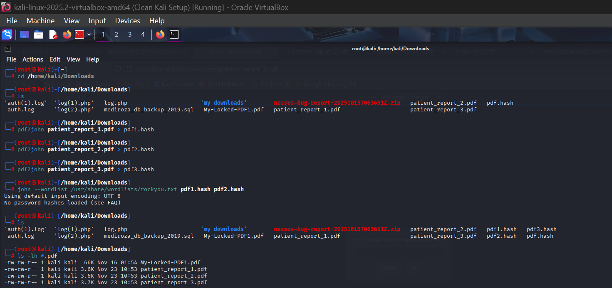
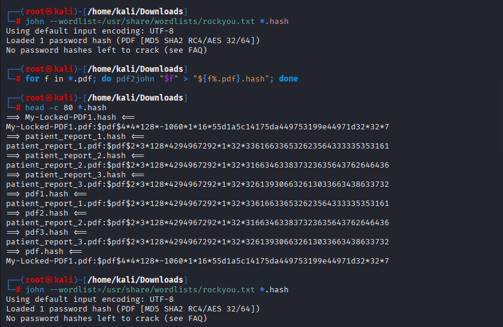

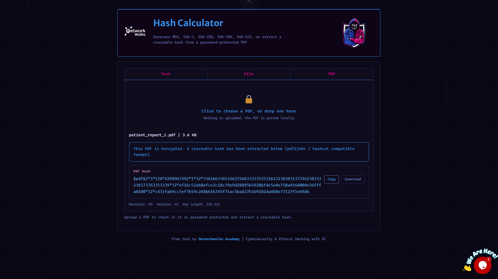

#### Evidence — Password Recovery (`John the Ripper`, `pdfcrack` & NW Cracker)
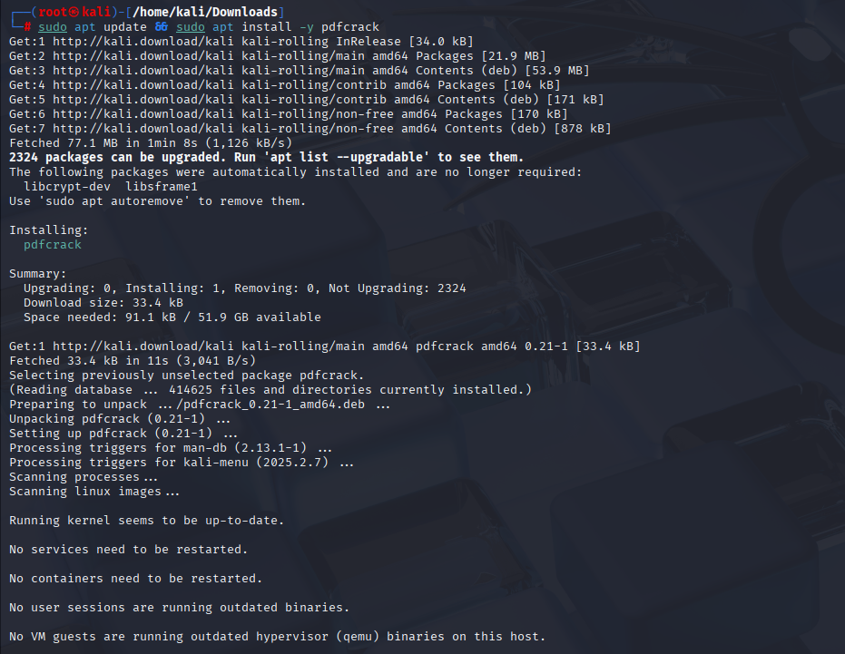
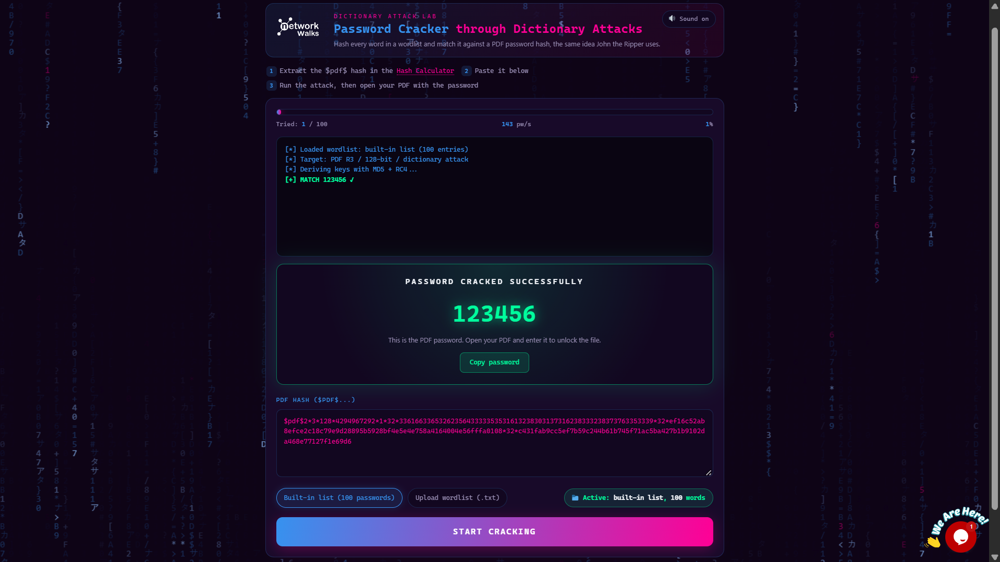
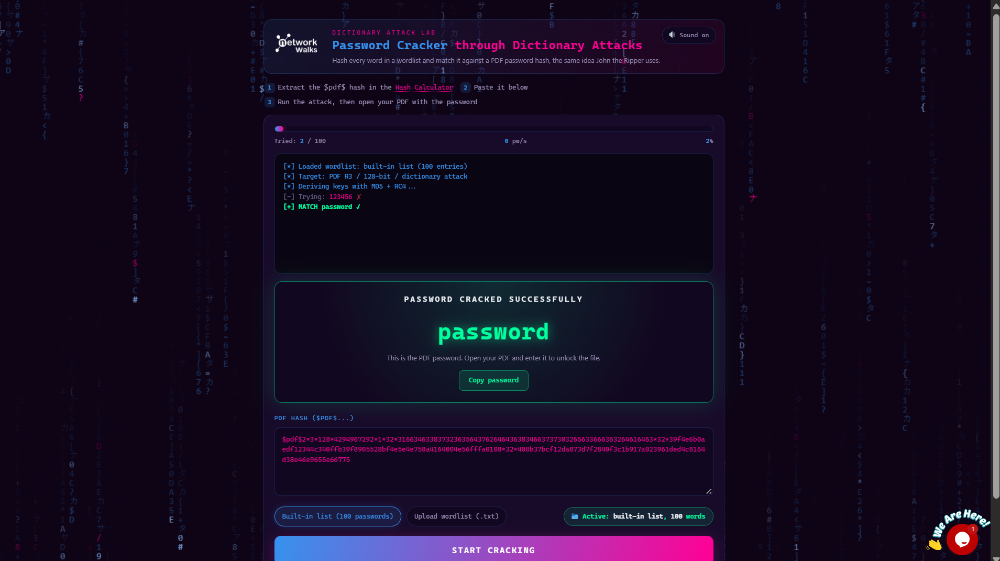

#### Evidence — Decrypted Patient Lab Reports
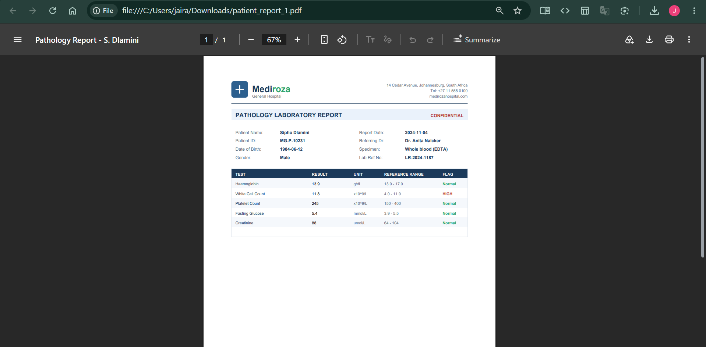
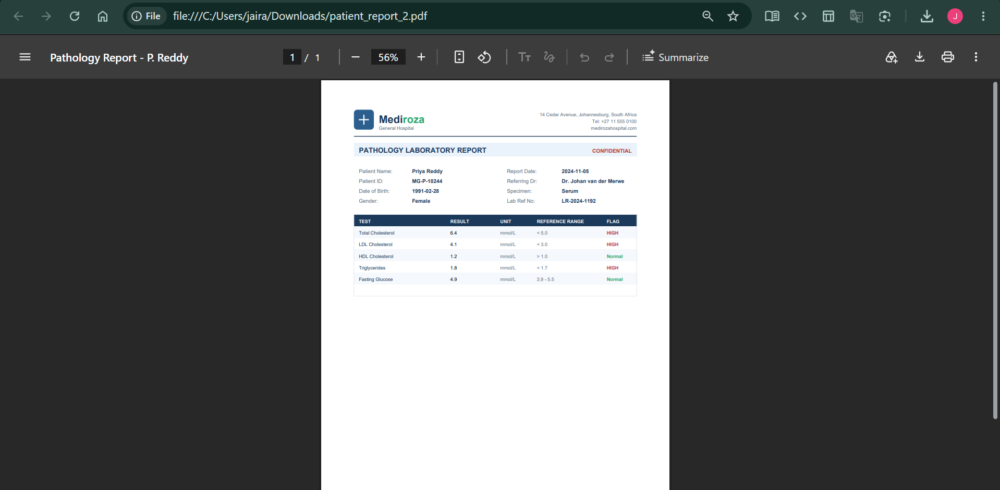

---

### Milestone 3: Critical Data Exposure (Staff Salaries & Shareholder Records)
- **Finding 3.1 — Unauthenticated Database Backup Exposure (`/old/`):** Navigating to `/old/` revealed an enabled directory listing containing a full SQL database dump (`mediroza_db_backup_2019.sql`).
- **Finding 3.2 — Compromise of Employee Compensation & Shareholder Data:** Inspecting the SQL dump exposed confidential `staff` table records (full names, job titles, departments, contact details, national IDs, and monthly salaries) alongside confidential `shareholder` ownership records.

#### Evidence — Exposed `/old/` Backup Directory & SQL Database Dump
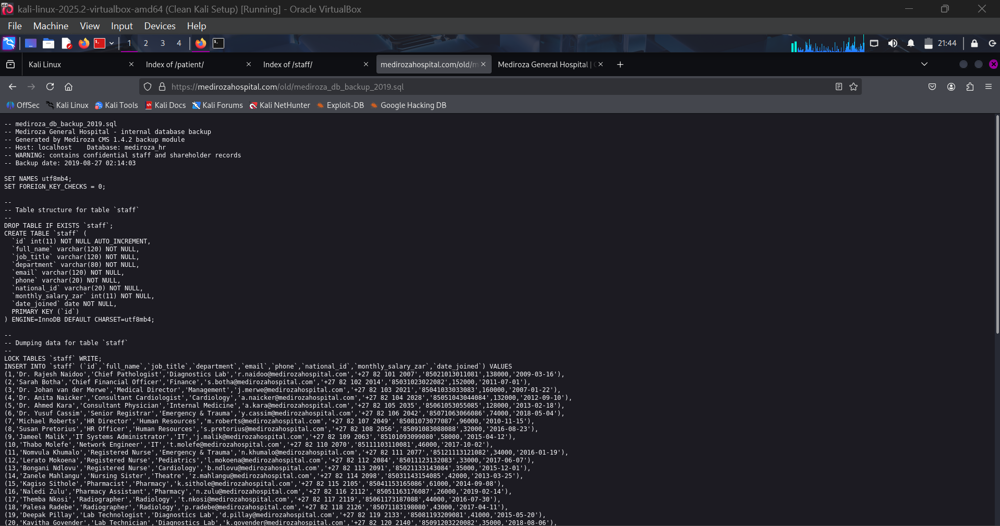
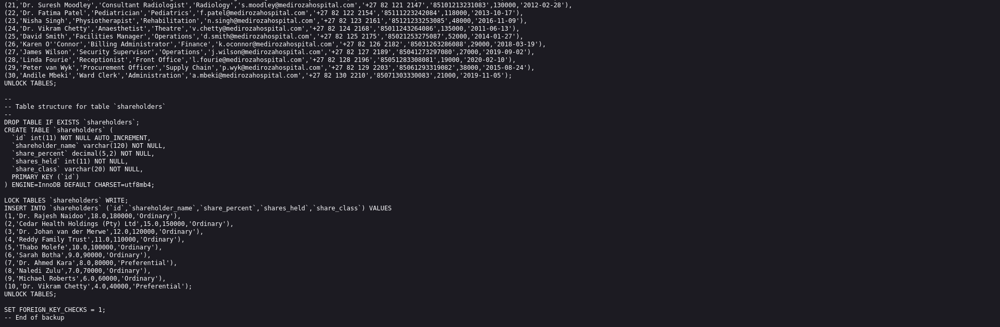

---

## 04. Risk Rating

| ID | Vulnerability / Finding | Affected Component | Severity | Business & Security Impact |
| :--- | :--- | :--- | :--- | :--- |
| **V-01** | **Unauthenticated SQL Database Backup Exposure** | `/old/mediroza_db_backup_2019.sql` | **Critical** | Full compromise of employee salaries, national IDs, contact info, and confidential shareholder data. |
| **V-02** | **Broken Access Control & Directory Listing** | `/patient/`, `/staff/`, `/old/` | **Critical** | Direct unauthorized enumeration and retrieval of sensitive medical reports and internal scripts. |
| **V-03** | **Weak PDF Document Passwords** | `patient_report_1–3.pdf` | **High** | Rapid offline dictionary/mask cracking exposes Protected Health Information (PHI). |
| **V-04** | **Verbose Database Error Reporting & SQLi** | `/patient/login.php` | **High** | Raw `mysqli_query()` syntax errors leak backend database technology and query structure. |
| **V-05** | **Sensitive Path Disclosure in `robots.txt`** | `/robots.txt` | **Medium** | Directly maps out restricted portals and legacy backup folders for attackers. |

---

## 05. Recommendations and Remediation

1. **Remove Public Backups & Enforce Strict Storage Controls (Critical):**
   - Immediately delete `mediroza_db_backup_2019.sql` and the `/old/` directory from the web root. Store database backups in encrypted, non-public cloud buckets or offline storage with strict IAM access controls.
2. **Disable Web Server Directory Indexing (Critical):**
   - Disable directory listings globally in Apache (`Options -Indexes` in `.htaccess` or `apache2.conf`) and restrict direct HTTP access to private document directories.
3. **Enforce Strong Document Encryption & Access Policies (High):**
   - Require high-entropy, randomly generated passwords (minimum 12–16 mixed characters) for exported patient reports, or serve reports exclusively through authenticated, session-validated HTTPS endpoints without static file links.
4. **Implement Parameterized Queries & Disable Debug Errors (High):**
   - Replace concatenated SQL strings with prepared statements (`mysqli_prepare()` / PDO) across all login and portal forms, and set `display_errors = Off` in `php.ini`.
5. **Sanitize `robots.txt` (Medium):**
   - Remove sensitive internal paths (`/patient/`, `/staff/`, `/old/`) from `robots.txt` and rely on server-side authentication rather than security through obscurity.

---

## Author
- **Name:** Jai Bhushan Rane | **Intern ID:** `NW-084-3I7` | **Batch:** `B084`

