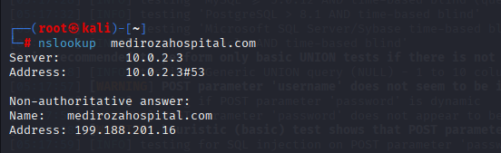
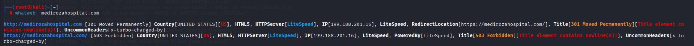
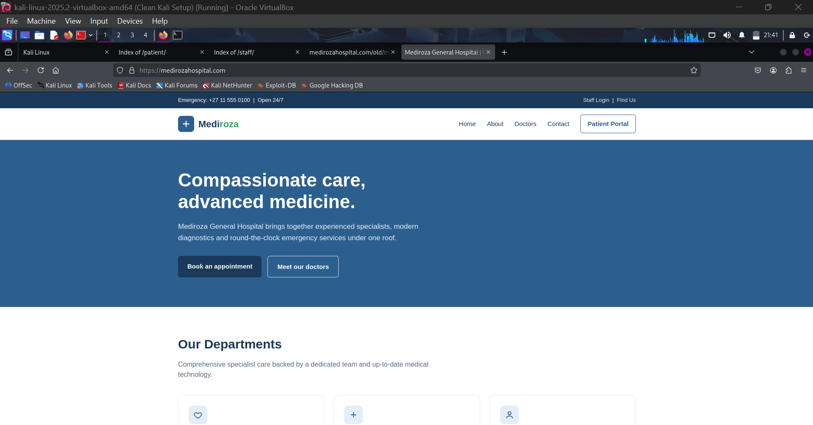
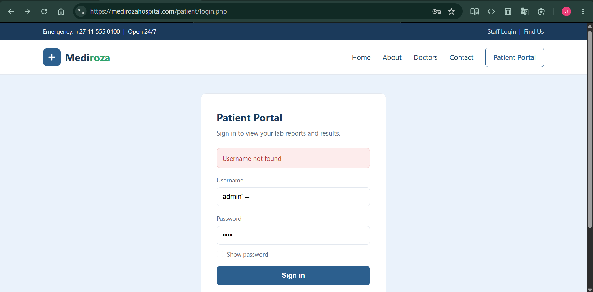
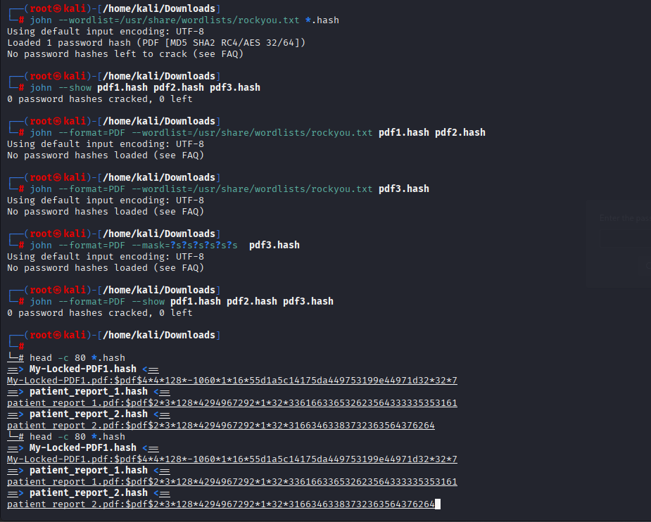
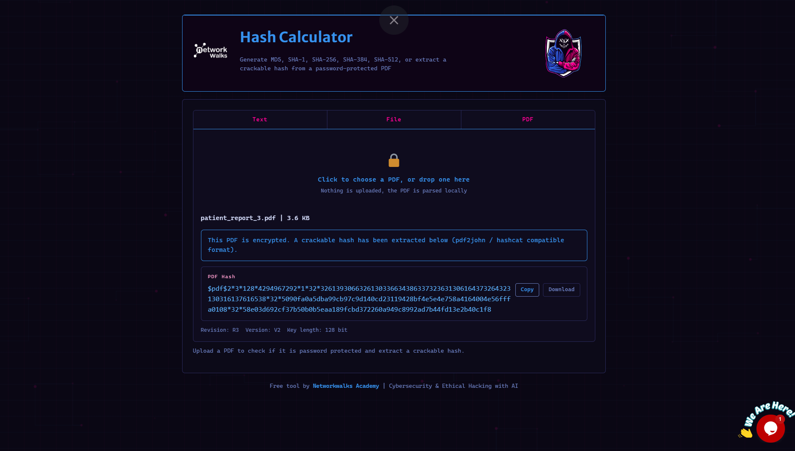
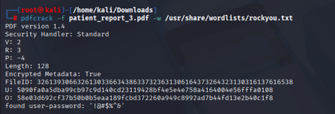
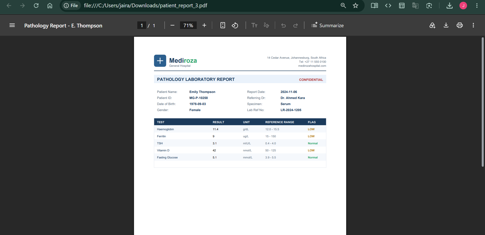
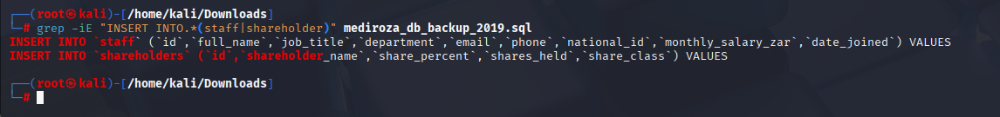

# Week 4 Capstone Project: Black-Box Penetration Testing Report — Mediroza General Hospital

## 01. Executive Summary
A black-box security assessment was conducted against **Mediroza General Hospital** (`https://medirozahospital.com`) as part of the **Networkwalks Cybersecurity Internship (Batch B084)**. The objective was to evaluate the security posture of the hospital's public-facing web infrastructure, patient portal access controls, document encryption practices, and sensitive data storage.

The assessment uncovered multiple **Critical** and **High** severity vulnerabilities, including exposed directory listings, sensitive administrative paths disclosed via `robots.txt`, weakly encrypted patient medical reports (`patient_report_1.pdf`, `patient_report_2.pdf`, `patient_report_3.pdf`), and an unauthenticated full database backup (`mediroza_db_backup_2019.sql`) containing staff compensation and confidential shareholder records. Immediate remediation is recommended to prevent unauthorized access to Protected Health Information (PHI) and corporate financial data.

---

## 02. Scope and Methodology

### Target & Engagement Details
- **Target Application:** `https://medirozahospital.com` (Mediroza General Hospital)
- **Assessment Type:** Authorized Black-Box Penetration Test
- **Assessor:** Jai Bhushan Rane | **Intern ID:** `NW-084-3I7` | **Batch:** `B084`
- **Tools Utilized:** `whois`, `nslookup`, `dnsrecon`, `whatweb`, `curl`, `wafw00f`, `nmap`, `nikto`, Web Browser & Developer Inspection, `pdf2john`, `John the Ripper (JTR)`, `pdfcrack`, `rockyou.txt` Wordlist, Networkwalks Hash Calculator, Networkwalks Password Cracker, `grep` / Text Analysis

### Assessment Phases
- **Phase 0 — Pre-Engagement Reconnaissance & Scanning:** Passive and active footprinting of domain, DNS, HTTP headers, WAF, network ports, and web server configurations.
- **Phase 1 (M1) — Initial Access & Patient Lab Report Retrieval:** Enumerating `robots.txt`, directory listings, and portal access controls to retrieve restricted patient medical reports.
- **Phase 2 (M2) — Data Extraction & PDF Encryption Auditing:** Extracting PDF password hashes and conducting offline dictionary and mask attacks to recover plaintext passwords and decrypt patient reports.
- **Phase 3 (M3) — Critical Data Exposure Analysis:** Auditing exposed legacy backup directories (`/old/`) and inspecting leaked SQL database dumps for employee salaries and shareholder records.
- **Phase 4 (M4) — Risk Classification & Remediation Reporting:** Assigning severity ratings and documenting actionable defensive remediations.

---

## 03. Findings and Proof of Exploitation

### Phase 0: Pre-Engagement Reconnaissance & Infrastructure Scanning
Before interacting with the web application portals, passive and active reconnaissance was executed against `medirozahospital.com` to map DNS records, server headers, WAF presence, open network ports, and web server configurations.

#### Evidence — Reconnaissance & Scanning (`./commands/`)
- **WHOIS Lookup (`whois.png`):**

- **Nslookup DNS Records (`nslookup.png`):**

- **DNSRecon Enumeration (`dnsrecon.png`):**

- **WhatWeb Fingerprinting (`whatweb.png`):**

- **cURL HTTP Headers (`curl.png`):**

- **Wafw00f Firewall Detection (`wafw00f.png`):**

- **Nmap Port & Service Scan (`nmap.png`):**

- **Nikto Web Vulnerability Scan 1 (`nikto1.png`):**

- **Nikto Web Vulnerability Scan 2 (`nikto2.png`):**

---

### Phase 1 (M1): Initial Access & Patient Lab Report Retrieval
- **Finding 1.1 — Sensitive Directory Disclosure via `robots.txt`:** Inspecting `/robots.txt` explicitly revealed restricted administrative and user directories (`/patient/`, `/staff/`, and `/old/`).
- **Finding 1.2 — Unauthenticated Directory Indexing & Portal Exposure:** Directory listing was left enabled across sensitive folders, exposing application scripts (`portal.php`, `download.php`, `error_log`) and enabling retrieval of three password-protected patient medical lab reports (`patient_report_1.pdf`, `patient_report_2.pdf`, `patient_report_3.pdf`).

#### Evidence — `robots.txt` & Directory Discovery
- **Robots.txt & Disallowed Paths (`01-robots1.png`):**

- **Robots.txt / Directory Check 2 (`01-robots2.png`):**

- **Robots.txt / Directory Check 3 (`01-robots3.png`):**

#### Evidence — Patient Portal & Report Access
- **Portal Access & Report Retrieval 1 (`02-portal-access1.png`):**

- **Portal Access & Report Retrieval 2 (`02-portal-access2.png`):**

---

### Phase 2 (M2): Data Extraction & PDF Encryption Auditing
- **Finding 2.1 — Weak Document Passwords on Patient Medical Reports:** Cryptographic hashes (`$pdf$2*3*128...`) were extracted from all three patient PDF files and audited using both offline CLI tools (`pdf2john`, `John the Ripper`, `pdfcrack`) and Networkwalks' online cryptographic utilities:
  - **`patient_report_1.pdf`:** Protected with a purely numeric sequence (`123456`).
  - **`patient_report_2.pdf`:** Protected with a top-10 dictionary word (`password`).
  - **`patient_report_3.pdf`:** Protected with a predictable keyboard symbol sequence (`!@#$%^&`).

#### Evidence — John the Ripper Cracking (`03-jtr-cracked1` to `03-jtr-cracked3`)
- **John the Ripper Crack 1 (`03-jtr-cracked1.png`):**

- **John the Ripper Crack 2 (`03-jtr-cracked2.png`):**

- **John the Ripper Crack 3 (`03-jtr-cracked3.png`):**

#### Evidence — Networkwalks Hash Calculator & Cracker (`03-nwhc-cracked1` to `03-nwhc-cracked3`)
- **NW Hash Calculator & Cracker 1 (`03-nwhc-cracked1.png`):**

- **NW Hash Calculator & Cracker 2 (`03-nwhc-cracked2.png`):**

- **NW Hash Calculator & Cracker 3 (`03-nwhc-cracked3.png`):**

#### Evidence — PDFCrack Recovery (`03-pdfcrack31.png`)
- **PDFCrack Symbol Password Recovery for PDF 3 (`03-pdfcrack31.png`):**

#### Evidence — Password Prompt Verification (`04-unlocked-pdfspass1` to `04-unlocked-pdfspass3`)
- **Entering Cracked Password for Report 1 (`04-unlocked-pdfspass1.png`):**

- **Entering Cracked Password for Report 2 (`04-unlocked-pdfspass2.png`):**

- **Entering Cracked Password for Report 3 (`04-unlocked-pdfspass3.png`):**

#### Evidence — Decrypted Patient Lab Reports (`05-unlocked-pdfs1` to `05-unlocked-pdfs3`)
- **Unlocked Patient Lab Report 1 (`05-unlocked-pdfs1.png`):**

- **Unlocked Patient Lab Report 2 (`05-unlocked-pdfs2.png`):**

- **Unlocked Patient Lab Report 3 (`05-unlocked-pdfs3.png`):**

---

### Phase 3 (M3): Critical Data Exposure (Staff Salaries & Shareholder Records)
- **Finding 3.1 — Unauthenticated Database Backup Exposure (`/old/`):** Navigating to `/old/` revealed an enabled directory listing containing a full SQL database dump (`mediroza_db_backup_2019.sql`).
- **Finding 3.2 — Compromise of Employee Compensation & Shareholder Data:** Inspecting the SQL dump exposed confidential `staff` table records (full names, job titles, departments, contact details, national IDs, and monthly salaries) alongside confidential `shareholder` ownership records.

#### Evidence — Exposed `/old/` Backup Directory & SQL Database Dump
- **Exposed `/old/` Directory Listing 1 (`06-old-folder1.png`):**

- **Exposed `/old/` Directory Listing 2 (`06-old-folder2.png`):**

- **Exposed Staff Salaries & Shareholder Records (`06-sql-salaries.png`):**

---

## 04. Phase 4 (M4): Risk Rating

| ID | Vulnerability / Finding | Affected Component | Severity | Business & Security Impact |
| :--- | :--- | :--- | :--- | :--- |
| **V-01** | **Unauthenticated SQL Database Backup Exposure** | `/old/mediroza_db_backup_2019.sql` | **Critical** | Full compromise of employee salaries, national IDs, contact info, and confidential shareholder data. |
| **V-02** | **Broken Access Control & Directory Listing** | `/patient/`, `/staff/`, `/old/` | **Critical** | Direct unauthorized enumeration and retrieval of sensitive medical reports and internal scripts. |
| **V-03** | **Weak PDF Document Passwords** | `patient_report_1–3.pdf` | **High** | Rapid offline dictionary/mask cracking exposes Protected Health Information (PHI). |
| **V-04** | **Verbose Database Error Reporting & SQLi** | `/patient/login.php` | **High** | Raw `mysqli_query()` syntax errors leak backend database technology and query structure. |
| **V-05** | **Sensitive Path Disclosure in `robots.txt`** | `/robots.txt` | **Medium** | Directly maps out restricted portals and legacy backup folders for attackers. |

---

